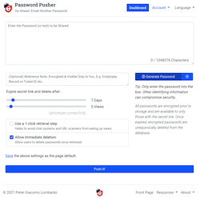
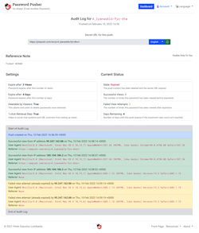
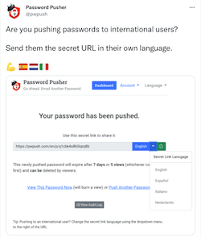
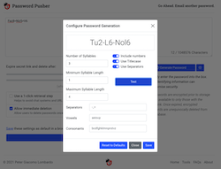
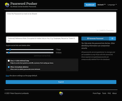
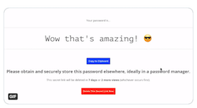
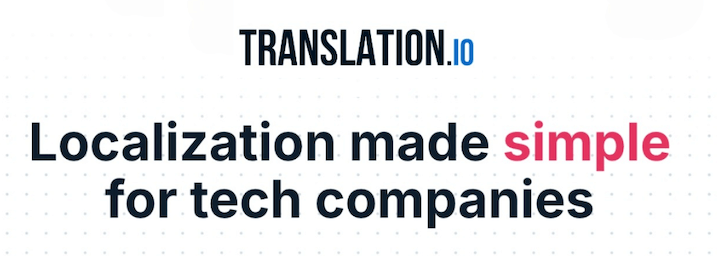

<div align="center">

[](https://pwpush.com/)

**Share passwords, text, files & URLs securely with self-deleting links and full audit logs.**

[](https://pwpush.com)
[](https://docs.pwpush.com)

[](https://hub.docker.com/r/pglombardo/pwpush)
[](https://hub.docker.com/r/pglombardo/pwpush-ephemeral)
[](https://github.com/pglombardo/PasswordPusher/blob/master/LICENSE)

[](https://github.com/pglombardo/PasswordPusher)

</div>

---

**v2.0 is released.** If you already self-host, see the **[upgrade guide](UPGRADE-2.0.md)** for migration notes and configuration changes.

---

## What is Password Pusher?

**Password Pusher** is an open source web app for sharing sensitive information safely. You push a password, note, file, or URL; the recipient gets a one-time link that expires after a set number of views and/or time. No more sending secrets over chat or email—encrypted, auditable, and auto-self-destruct.

Use the [hosted service](https://pwpush.com) or run your own instance with Docker in minutes.

---

## Why Password Pusher?

| | |
|---|---|
| **🔒 Secure by default** | Encrypted storage, optional passphrase, expiry by views and/or time. Sensitive data is removed entirely once expired. |
| **📋 Full audit trail** | See when links were created, viewed, and by whom (with logins). |
| **🏠 Self-host or use hosted** | Use [pwpush.com](https://pwpush.com) or deploy your own—Docker, Kubernetes, Helm, or [one-click cloud](#one-click-deploy). |
| **🌐 Ready for teams** | 31 languages, light/dark theme, JSON API, [official CLI & Chrome Extension](#tools--extensions), and [many integrations](https://docs.pwpush.com/docs/3rd-party-tools/). |

---

## Financial Supporters

A heartfelt thank you to the companies and individuals who help keep Password Pusher running. Their support goes toward hosting, maintenance, support and continued development.

| Supporter | |
|---|---|
| [](https://serpapi.com/?utm_source=pwpush) | SerpApi is the world’s leading provider of search data, pioneering APIs that turn search engine results into structured, developer-ready information. |
| [WMACCESS](https://www.wmaccess.com/) |  Provides securities information and tax-relevant financial data, including securities master data and income data for comprehensive tax reporting. |

A special thank you as well to every customer who [subscribed to a plan on pwpush.com](https://eu.pwpush.com/pricing) or purchased [Self-Hosted Pro](https://eu.pwpush.com/self-hosted-pricing) — your support directly funds the ongoing development of Password Pusher.

Interested in supporting Password Pusher? Reach out at [support@pwpush.com](mailto:support@pwpush.com).

---

## Features

### Security & privacy

- **Encrypted at rest** — Sensitive data is stored encrypted and deleted when expired.
- **Expiry controls** — Limit by number of views and/or time; links can require a passphrase.
- **Two-factor authentication (MFA)** — TOTP (authenticator apps) with backup codes; admins can require MFA instance-wide with `PWP__REQUIRE_MFA=true`.
- **Audit logging** — Track what was shared and who viewed it (with optional logins).
- **Unbranded delivery page** — No logos, superfluous text or unrelated links to confuse push recipients.

### Self-host & customize

- **One-command deploy** — Docker Compose with automatic SSL/TLS
- **One-click cloud deploy** — Managed hosts and platform buttons. See [One-click deploy](#one-click-deploy).
- **Database or ephemeral** — Use a database for persistence or run stateless.
- **Admin dashboard** — Manage your instance from a built-in admin UI.
- **White-label** — Custom theme, logo, site name, and [26 Bootswatch themes](https://docs.pwpush.com/docs/themes/) via env vars.
- **Custom CSS** — Add your own styles; light/dark follows system preference.

### Integrations & API

- **JSON API v2** — Modern `/api/v2` endpoints for create/retrieve/audit/active/expired workflows.
- **Legacy API compatibility** — Existing `/p`, `/f`, `/r` API routes (v1 style) remain available for backwards compatibility.
- **CLI** — Official [pwpush CLI](https://github.com/pglombardo/pwpush-cli) plus [3rd-party tools](https://docs.pwpush.com/docs/3rd-party-tools/) and scripts.
- **31 languages** — UI and secret-URL pages in 31 languages (courtesy of [Translation.io](https://translation.io/?utm_source=pwpush)).

### Trust & community

- **Open source** — Apache 2.0; no black box. Written and maintained by [myself](https://github.com/pglombardo) and the team at [Apnotic](https://apnotic.com) with the help of contributors.
- **15+ years in production** — Used to deliver millions of secrets; [actively maintained](https://github.com/pglombardo/PasswordPusher/graphs/contributors).
- **Trusted worldwide** — Used by thousands of companies around the globe.

---

## Screenshots

| [](app/assets/images/features/front-page-large.png) | [](app/assets/images/features/audit-log-large.png) | [](app/assets/images/features/secret-url-languages-large.png) |
|:---:|:---:|:---:|
| **Create a push** | **Audit log** | **Multi-language URLs** |

| [](app/assets/images/features/password-generator-large.png) | [](app/assets/images/features/dark-theme.gif) | [](app/assets/images/features/preliminary-step.gif) |
|:---:|:---:|:---:|
| **Password generator** | **Dark theme** | **Optional preview step** |

---

## Editions

| | **Open source (this repo)** | **Pro (pwpush.com)** |
|---|---|---|
| **Try it** | [oss.pwpush.com](https://oss.pwpush.com) | [pwpush.com](https://pwpush.com) |
| **Use case** | Self-host or use OSS demo | Hosted Pro with extra features |
| **Details** | Full source here; you deploy or use the OSS demo. | Pro features are [periodically migrated](https://docs.pwpush.com/docs/editions/) to OSS. |

**Feature comparison:** [pwpush.com/features#matrix](https://pwpush.com/features#matrix)

### Self-Hosted Password Pusher Pro

Self-hosted **Pro** (with licensing) is now available. Pro features not yet in OSS will be available for self-hosted deployments.

---

## Quick Start

### Use the hosted service

No setup: **[pwpush.com](https://pwpush.com)** — create a push and share the link.

### One-click deploy

Deploy your own instance without setting up a server. You pay the provider directly. This is self-hosting, separate from the hosted service at [pwpush.com](https://pwpush.com).

| | |
|---|---|
| <a href="https://cloudzy.com/marketplace/password-pusher"></a> | **[Cloudzy](https://cloudzy.com/marketplace/password-pusher)** — Marketplace VPS. Cloudzy handles deployment and infrastructure support. |
| <a href="https://elest.io/open-source/password"></a> | **[Elestio](https://elest.io/open-source/password)** — Managed hosting on 9 cloud providers. Pick a provider and region; updates and backups are included. |
| <a href="https://www.pikapods.com/pods?run=pwpush"></a> | **[PikaPods](https://www.pikapods.com/pods?run=pwpush)** — Managed pod from their app catalog. |
| <a href="https://www.hostinger.com/applications/password-pusher"></a> | **[Hostinger](https://www.hostinger.com/applications/password-pusher)** — One-click Docker deploy on a Hostinger VPS. Hostinger maintains the application template. |
| <a href="https://cloud.digitalocean.com/apps/new?repo=https://github.com/pglombardo/PasswordPusher/tree/master"></a> | **[DigitalOcean App Platform](https://cloud.digitalocean.com/apps/new?repo=https://github.com/pglombardo/PasswordPusher/tree/master)** — [.do/deploy.template.yaml](.do/deploy.template.yaml) builds the production Docker image and attaches Postgres. Replace the two secret placeholders before launch. |
| <a href="https://render.com/deploy?repo=https://github.com/pglombardo/PasswordPusher"></a> | **[Render](https://render.com/deploy?repo=https://github.com/pglombardo/PasswordPusher)** — [render.yaml](render.yaml) builds the production Docker image with Postgres and a disk for uploads. |
| <a href="https://www.heroku.com/deploy?template=https://github.com/pglombardo/PasswordPusher"></a> | **[Heroku](https://www.heroku.com/deploy?template=https://github.com/pglombardo/PasswordPusher)** — Uses [app.json](app.json). Heroku charges for the web dyno, worker dyno, and Postgres. |
| <a href="https://zop.dev/zopday/app/deploy?image=pglombardo/pwpush:latest&amp;port=5100&amp;name=pwpush&amp;utm_source=github&amp;utm_medium=one_click&amp;utm_content=passwordpusher"></a> | **[ZopDay](https://zop.dev/zopday/oss?utm_source=github&utm_medium=one_click&utm_content=passwordpusher)** — Run it on managed ZopCloud or in an AWS or GCP account you already own. |
| <a href="https://pethost.dev/templates/password-pusher/"></a> | **[Pethost](https://pethost.dev/templates/password-pusher/)** — A one-click template on a server of your own plan, with SQLite in a volume and nightly backups. |
| [](https://app.railyard.run/deploy?repo=https://github.com/pglombardo/PasswordPusher) | **[Railyard](https://app.railyard.run/deploy?repo=https://github.com/pglombardo/PasswordPusher)** — Free, BYO-server PaaS. Deploys to a server in your own DigitalOcean, Hetzner, Vultr or AWS account, reading the Dockerfile here directly. |

Railway and Fly.io are not marketplace buttons. Launch from their dashboard or CLI using the config in this repo:

| | |
|---|---|
| <a href="https://railway.com/"></a> | **[Railway](https://railway.com/)** — Connect this repo. [railway.toml](railway.toml) sets the Dockerfile. Add Postgres and set `SECRET_KEY_BASE` and `PWPUSH_MASTER_KEY` in the dashboard. |
| <a href="https://fly.io/"></a> | **[Fly.io](https://fly.io/)** — [fly.toml](fly.toml) and `containers/docker/Dockerfile`. Run `fly launch`, set secrets, then attach Postgres. |

Install details: **[docs.pwpush.com/docs/installation](https://docs.pwpush.com/docs/installation/)**.

### Run your own instance with Docker Compose

1. Point a DNS record to your server (e.g. `pwpush.example.com`).
2. Clone this repo or download [docker-compose.yml](https://raw.githubusercontent.com/pglombardo/PasswordPusher/refs/heads/master/docker-compose.yml).
3. In `docker-compose.yml`, uncomment and set:
   - `TLS_DOMAIN: 'pwpush.example.com'` (for automatic Let’s Encrypt TLS).
   - Optionally set `PWPUSH_MASTER_KEY` (see comments in the file; generate at [us.pwpush.com/generate_key](https://us.pwpush.com/generate_key)).
4. Run:

```bash
docker compose up -d
```

Open `https://pwpush.example.com`. The Compose file includes persistent storage, health checks, and is suitable for production.

_Note: If you didn't set `TLS_DOMAIN`, uncomment port 5100 and visit the application on http://your-ip:5100_

### Local development

| File / path | Use |
|-------------|-----|
| [.devcontainer/](.devcontainer/) | VS Code / GitHub Codespaces: Ruby + Postgres, repo mounted at `/workspace`, `bin/setup`. |

Production image build: [containers/docker/Dockerfile](containers/docker/Dockerfile). Root [docker-compose.yml](docker-compose.yml) uses the published image; [.devcontainer/docker-compose.yml](.devcontainer/docker-compose.yml) is for development with a mounted working tree.

### Use the API, CLI, or integrations

For API usage, CLI tools, and integrations:

- **pwpush CLI**: [github.com/pglombardo/pwpush-cli](https://github.com/pglombardo/pwpush-cli) — Official command-line tool for pushing secrets from the terminal
- API v2 docs: [docs.pwpush.com/docs/api-v2](https://docs.pwpush.com/docs/api-v2/)
- OSS API endpoint reference in-app: `/api/v2/version` and `/api/v2/pushes`
- 3rd-party tools: [docs.pwpush.com/docs/3rd-party-tools](https://docs.pwpush.com/docs/3rd-party-tools/)

Quick API v2 smoke test:

```bash
curl -s https://YOUR_HOST/api/v2/version
```

---

## Tools & Extensions

Enhance Password Pusher with these official companion tools:

| CLI | Chrome Extension |
|:---:|:---:|
| [](https://github.com/pglombardo/pwpush-cli) | [](https://chromewebstore.google.com/detail/djdnbhbnimfpfmnocchfhjahinieaacg) |
| Command-line tool for pushing secrets from the terminal | Create pushes directly from your browser with self-hosted & APIv2 support |

---

## Documentation

Full docs: **[docs.pwpush.com](https://docs.pwpush.com)** — installation, configuration, API, themes, and more.

---

## Language translations

**[Translation.io](https://translation.io/?utm_source=pwpush)** has provided free translation tooling for the OSS version of Password Pusher. The app ships with **31 UI languages**.

[](https://translation.io/?utm_source=pwpush)

Consider [Translation.io](https://translation.io/?utm_source=pwpush) for your company or project’s translation needs.

---

## Credits

### Security researchers

- **Kullai Metikala** — [GitHub](https://github.com/kullaisec) \| [LinkedIn](https://www.linkedin.com/in/kullai-metikala-8378b122a/)
- [Positive Technologies](https://global.ptsecurity.com)
- **Igniter** — [GitHub](https://github.com/igniter07)

### Translators

| Name | Language |
|------|----------|
| [Oyale](https://github.com/oyale) | [Catalan](https://pwpush.com/ca), [Spanish](https://pwpush.com/es) |
| Finn Skaaning | [Danish](https://pwpush.com/da/p/ny) |
| [Mihail Tchetchelnitski](https://github.com/mtchetch) | [Finnish](https://pwpush.com/fi/p/uusi) |
| [Thibaut](https://github.com/tibo59) | [French](https://pwpush.com/fr/p/Nouveau) |
| Thomas Wölk | [German](https://pwpush.com/de/p/neu) — [GitHub](https://github.com/confluencepoint), [Twitter](https://twitter.com/confluencepoint) |
| Martin Otto | [German](https://pwpush.com/de/p/neu) |
| Robin Jørgensen | [Norwegian](https://pwpush.com/no/p/ny) |
| [Łukasz](https://github.com/drpt) | [Polish](https://pwpush.com/pl/p/nowy) |
| [Jair Henrique](https://github.com/jairhenrique/), [Fabrício Rodrigues](https://www.linkedin.com/in/ifabriciorodrigues/), [Ivan Freitas](https://github.com/IvanMFreitas), Sara Faria | [Portuguese (BR)](https://pwpush.com/pt-br/p/novo) |
| Pedro Marques | [European Portuguese](https://pwpush.com/pt-pt/p/novo) |
| johan323, Fredrik Arvas | [Swedish](https://pwpush.com/sv/p/ny) |

Thanks also to [Translation.io](https://translation.io) for managing translations (free for open source).

### Containers & infrastructure

- [@fiskhest](https://github.com/fiskhest) — [Kubernetes manifests](https://github.com/pglombardo/PasswordPusher/tree/master/containers/kubernetes)
- [@sfarosu](https://github.com/sfarosu) — [Docker, Kubernetes & OpenShift support](https://github.com/pglombardo/PasswordPusher/pull/82)
- [sirux88](https://github.com/sirux88) — Docker cleanup and multistage builds

### Other

- [@iandunn](https://github.com/iandunn) — Password form security
- [Kasper Grubbe](https://github.com/kaspergrubbe) — [JSON POST fix](https://github.com/pglombardo/PasswordPusher/pull/3)
- [JarvisAndPi](http://www.reddit.com/user/JarvisAndPi) — Favicon design

More: [Contributors](https://github.com/pglombardo/PasswordPusher/graphs/contributors)

---

## Stay updated

- **Newsletter** — [Sign up](https://buttondown.email/pwpush?tag=github) for release notes, security updates, and tips.
- **Social** — [X](https://x.com/pwpush), [Reddit](https://www.reddit.com/r/pwpush), [Facebook](https://www.facebook.com/pwpush)

---

## Donations

🛑 **Because of some abuse, the donation link is temporarily disabled.  Contact support@pwpush.com if you'd like to donate**

--> _To those testing various cards and failing, do what you do but please not here.  We can't risk getting the account flagged in Stripe - we're not big enough to deal with that type of damage.  I hope you can understand our position._

Donations are **optional**. Password Pusher is and will remain open source and free to use.

If it’s useful to you and you’d like to support development, donations are greatly appreciated and go toward hosting, maintenance, testing, and new features.

| [](https://buy.stripe.com/7sI4gCgTT1tr6WY3cd) | [**Donate via Stripe**](https://buy.stripe.com/7sI4gCgTT1tr6WY3cd) |
|---|---|

You can also support the project with a [paid plan on pwpush.com](https://pwpush.com/pricing).

**Note:** Password Pusher is operated by Apnotic, LLC. Donations support the project but are not tax-deductible charitable contributions. See [FAQ](https://docs.pwpush.com/docs/faq/) for more on [Apnotic](https://docs.pwpush.com/docs/faq/#what-is-apnotic) and [trust & security](https://docs.pwpush.com/docs/faq/#trust-is-a-concern--why-should-i-trust-and-use-password-pusher).

---

## Star history

[](https://star-history.dera.page/#pglombardo/PasswordPusher&type=date&legend=top-left)

---

## License

This project is licensed under the **Apache License 2.0**. See [LICENSE](https://github.com/pglombardo/PasswordPusher/blob/master/LICENSE) for details.

---

## Citation

```bibtex
@misc{PasswordPusher,
  author = {Peter Giacomo Lombardo},
  title = {Password Pusher: Securely share sensitive information with automatic expiration and deletion. Track who, what and when with full audit logs.},
  year = {2026},
  publisher = {GitHub},
  howpublished = {\url{https://github.com/pglombardo/PasswordPusher}}
}
```
